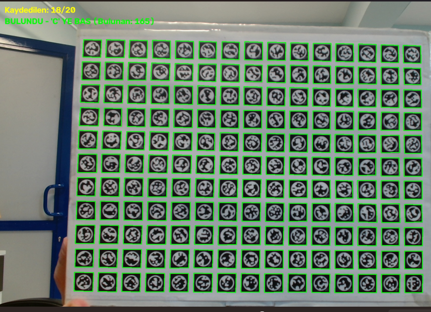

# Camera Calibration and STag Marker Pose Estimation

A computer vision project from my internship at Visea İnovatif.
I captured images of a physical STag marker board from different
viewpoints to calibrate a camera and use the calibration for pose estimation.

## Workflow

1. `1_kalibrasyon.py` uses OpenCV to estimate the camera matrix and lens
   distortion coefficients from marker observations. It reports the RMS
   reprojection error and saves the parameters to `kamera_parametreleri.npz`.
2. `2_stag_poz_tahmini.py` loads the saved parameters, a marker map, and
   reference marker coordinates for pose estimation.

## Running locally

The pose estimation script uses OpenCV, NumPy, and STag.

1. Configure the calibration script to use your marker board images.
   From the repository directory, run `python 1_kalibrasyon.py` to
   generate `kamera_parametreleri.npz`.
2. Place `marker_haritasi.txt` (relative marker positions) and
   `gercek_konumlar.txt` (reference marker coordinates) in the same
   working directory.
3. Run `python 2_stag_poz_tahmini.py` from that directory.
  ## Demo

